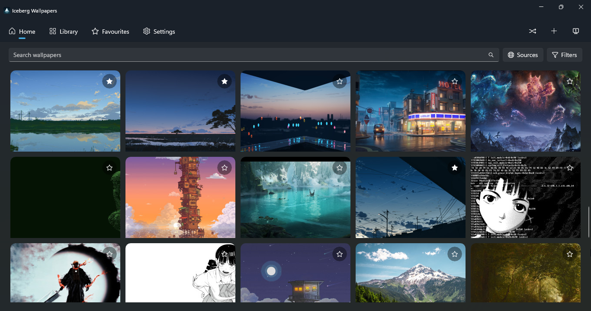
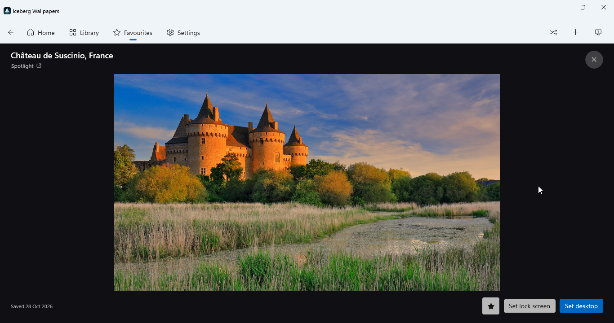
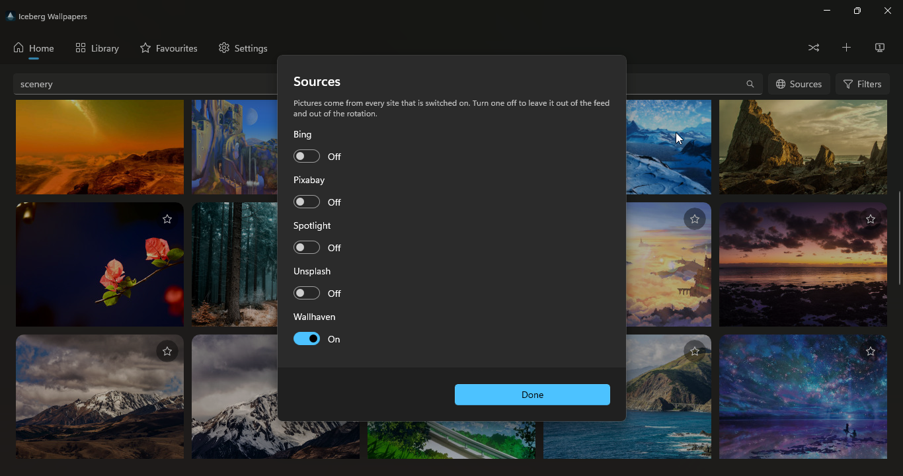
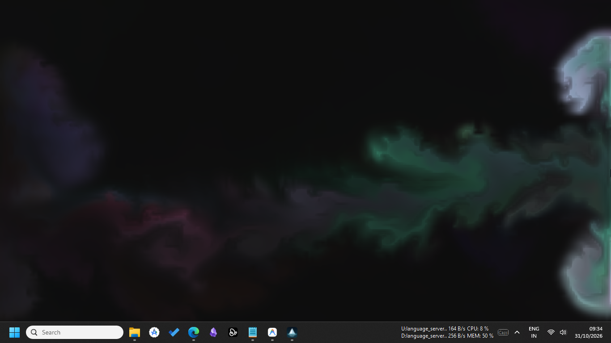
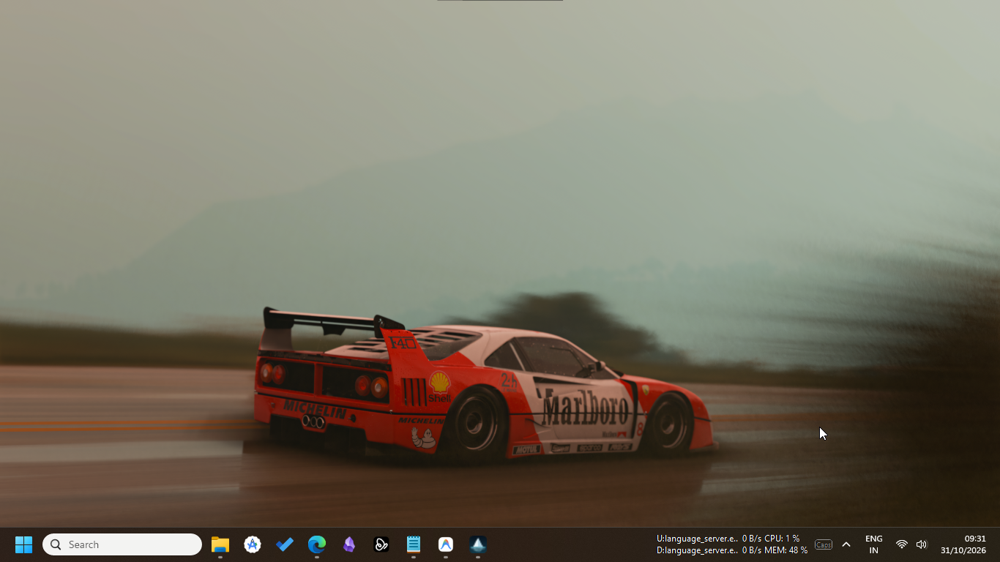
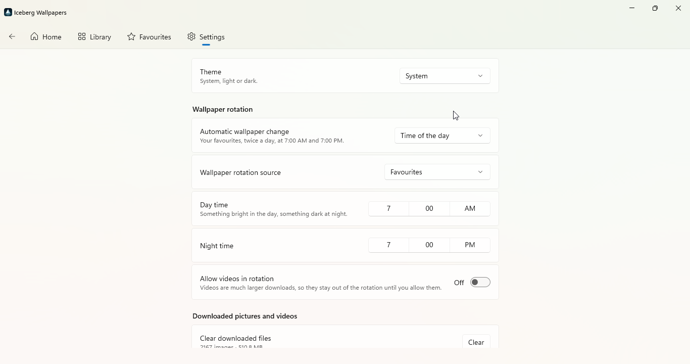
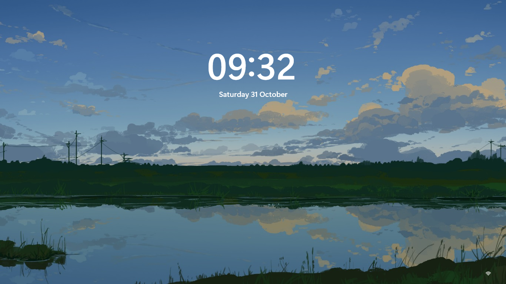
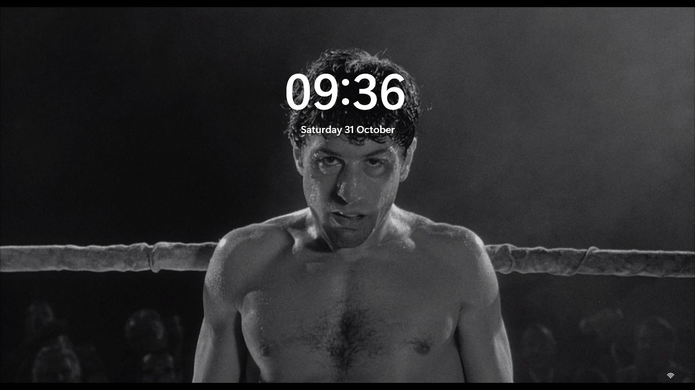

# Iceberg Wallpapers

A quiet wallpaper app for Windows. It finds pictures from a handful of good
sites, changes them on a schedule you choose, and stays out of the way in the
notification area.

Iceberg is built on [Lively Wallpaper](https://github.com/rocksdanister/lively)
by Rocksdanister. The engine, the player code and most of the plumbing are
Lively's work. Iceberg adds its own sources, filters, rotation and a simpler
interface on top. Thank you to Rocksdanister and every Lively contributor.

## What it does

- **Five picture sources.** Wallhaven, Unsplash, Pixabay, the Bing daily image
  and Windows Spotlight.
- **Filters that match each site.** One dialog, with a block per switched-on
  site showing that site's real options.
- **Photos, illustrations and videos.** Videos play a small muted preview when
  you hover over them. The full file is only downloaded when you apply it.
- **Rotation with one simple choice.** Change at sunrise and sunset, or on a
  timer. Videos and GIFs stay out of the rotation unless you switch them on.
- **Lives in the tray.** It never opens a window when Windows starts. Closing
  the window leaves rotation running. The tray icon brings it back.
- **Light, dark, or follow Windows.** The app never tints itself from the
  wallpaper.
- **Interactive living wallpapers.** Supports interactive wallpapers like Nagomi Living Koi Pond, procedurally animated and driven by local time and live weather.

## Screenshots

| Home Feed | Full Preview | Source Selection |
| :---: | :---: | :---: |
|  |  |  |

| Interactive Wallpaper | Desktop Wallpaper | Rotation Settings |
| :---: | :---: | :---: |
|  |  |  |

| Lock Screen Wallpaper | Lock Screen Rotation |
| :---: | :---: |
|  |  |

## Requirements

- Windows 10 version 1809 or later, or Windows 11
- 64-bit (x64) Windows

## Install

Iceberg is distributed through the Microsoft Store. There is no loose
installer.

## Build from source

You need the .NET 9 SDK, the Windows App SDK and Visual Studio 2022 with the
Windows application development workload.

1. Copy `secrets/ApiKeys.example.props` to `secrets/ApiKeys.local.props`.
2. Fill in your own free API keys for Wallhaven, Unsplash and Pixabay. Bing and
   Spotlight need no key.
3. Build:

```powershell
dotnet build src/Lively/Lively.UI.WinUI/Lively.UI.WinUI.csproj -c Debug -p:Platform=x64
```

`secrets/ApiKeys.local.props` is ignored by git and must never be committed.
The build reads the keys from it and generates a file inside `obj/`, which is
also ignored. A script, `scripts/check-secrets.ps1`, fails if a key-shaped
string appears in a tracked file.

Run the tests with:

```powershell
dotnet test src/Lively/Lively.Discovery.Tests/Lively.Discovery.Tests.csproj
dotnet test src/Lively/Lively.Sources.Tests/Lively.Sources.Tests.csproj
dotnet test src/Lively/Lively.Imaging.Tests/Lively.Imaging.Tests.csproj
```

## Privacy

Iceberg has no account, no analytics and no advertising. It talks to the
picture sites you switch on, and to nothing else. See [PRIVACY.md](PRIVACY.md).

## Acknowledgements & Credits

- [Lively Wallpaper](https://github.com/rocksdanister/lively) by Dani John (rocksdanister) - the foundation and core wallpaper engine.
- [Nagomi](https://github.com/msk1039/nagomi) by Mayank ([@msk1039](https://github.com/msk1039)) - interactive, procedurally animated koi pond that runs in your browser, adapted as a time-and-weather aware live wallpaper.
- Wallhaven, Unsplash, Pixabay, Microsoft Bing, and Windows Spotlight for wallpaper imagery.

## License

Iceberg is free software under the GNU General Public License version 3. See
[LICENSE](LICENSE).

It is a fork of Lively Wallpaper, also GPL-3.0. Iceberg is not affiliated with
Microsoft. Wallhaven, Unsplash, Pixabay, Bing and Windows Spotlight are services
of their respective owners.
